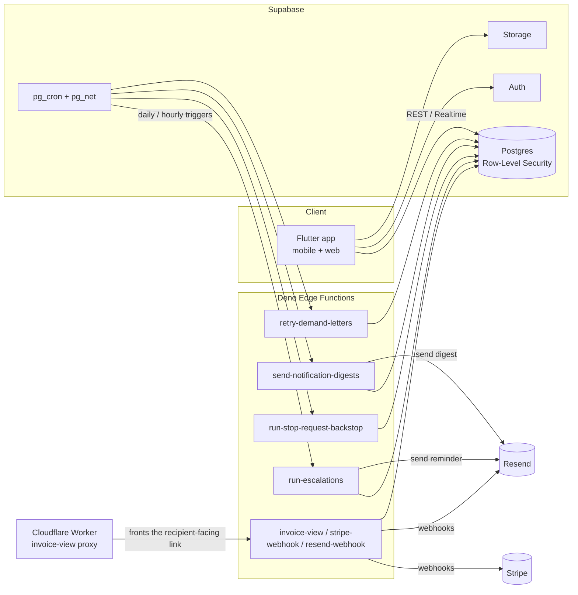
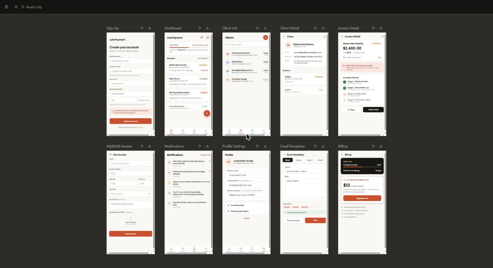
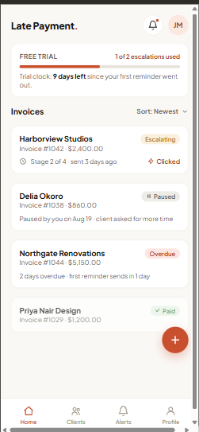
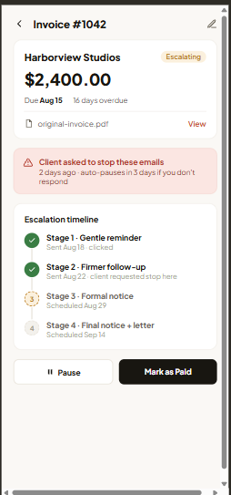
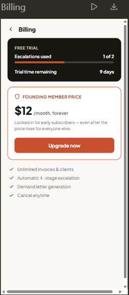

# Late Payment Escalator

**Late Payment Escalator** is a SaaS tool for freelancers that automates chasing overdue client invoices: a fixed day‑3 / 7 / 14 / 30 reminder sequence, a generated demand letter at the end of it, click tracking on every recipient-facing link, a client-facing "stop these emails" request flow with a 5-day auto-pause backstop, and in-app/email notifications for the freelancer. It replaces the awkward manual follow-up email with a sequence the freelancer never has to write themselves.

**Status:** in active development and manual testing. The backend (Supabase Postgres + Deno Edge Functions) is deployed and running in production against a real test account; the Flutter client is in testing ahead of a Play Store closed-testing release.

This is a **curated snapshot of a private repository** — 251 commits, 21 Aug 2026 – 26 Oct 2026. The full codebase and commit history are available to recruiters on request.

---

## Architecture

The chasing flow itself is a daily `pg_cron` job (`run-escalations`) that walks every `overdue`/`escalating` invoice, works out the next due reminder stage from its due date and any accumulated pause time, and sends it through Resend — each send recorded immutably once it reaches `sent`. A second daily cron (`run-stop-request-backstop`) auto-pauses any invoice whose client "stop emailing me" request has gone unresolved for 5 days. A third (`send-notification-digests`) rolls up in-app activity into an hourly email digest.

---

## Tech stack

| Layer | Technology |
|---|---|
| Client | Flutter (mobile + web, single codebase) |
| Database | Supabase Postgres, Row-Level Security on every table |
| Auth | Supabase Auth |
| Backend logic | Supabase Edge Functions (Deno + TypeScript) |
| Scheduling | `pg_cron` + `pg_net` |
| Billing | Stripe (Checkout, subscriptions, customer portal) |
| Email | Resend (transactional) |
| File storage | Supabase Storage (invoice PDFs, demand letters) |
| Hosting glue | Cloudflare Worker (proxies the recipient-facing invoice view) |

---

## Screenshots

These are the UI design mockups the Flutter app was built from (not live app screenshots — the real UI matches this closely but isn't identical).

| Dashboard | Invoice Detail — escalation timeline & stop-request alert | Billing |
|---|---|---|
|  |  |  |

---

## Engineering highlights

- **251 commits** over **21 Aug 2026 – 26 Oct 2026**, built test-first throughout.
- **27 SQL migrations** (`/schema`) — every table ships with Row-Level Security from the migration that creates it, not bolted on later.
- **Row-level security & data isolation.** Every table is scoped so a freelancer can only ever see their own clients, invoices, and escalation data — enforced in Postgres itself, not just in application code, and verified by a dedicated cross-user isolation suite (`rls_isolation_test.dart`) plus per-feature RLS tests (e.g. `email_templates_test.dart`, `demand_letters_test.dart`). Sensitive columns get extra locks: trial/usage columns and subscription rows are writable only by the `service_role`, never by the signed-in user directly (`0007_lock_trial_columns.sql`, `subscriptions_table_test.dart`).
- **An audit trail of client actions.** Every link a client clicks is recorded (`invoice_link_clicks`), every "stop these emails" request is timestamped and tracked to resolution (`stop_requests`), and every reminder send is immutable once it reaches `send_state = 'sent'` — stage rows are never edited in place, only a `failed` row is retried. Together these give a freelancer (and, if ever disputed, the freelancer's client) a complete record of what was sent, what was clicked, and what was asked for.
- **A 5-day auto-pause safeguard.** If a client asks to stop receiving reminders and nobody acts on it, the request doesn't just sit there — `run-stop-request-backstop` runs daily and auto-pauses every affected invoice once 5 days pass unresolved, closing the gap between "client asked" and "freelancer noticed" (sample in `/samples/edge-function-stop-request-backstop`).
- **A due-date-edit loophole closed by design.** Every invoice carries a `current_schedule_version`. Editing an invoice's due date bumps that version, which invalidates the prior set of escalation-stage rows and recomputes the reminder timeline cleanly from the new date — so an edited due date can't leave stale or duplicate reminders scheduled against the old one.
- **A multi-LLM spec review process before any code was written.** The initial spec went through four independent review rounds — Gemini → ChatGPT → DeepSeek → Claude — each one revising the brainstorm and spec documents and self-evaluating its own changes (`docs` kept as `review-rounds/v1-gemini.md` … `v4-claude.md` in the full repo). This caught real design gaps early, e.g. a trial-abuse loophole (deleting invoices to reset a usage limit) and a mis-anchored trial clock, before either reached production.
- **A silent email-delivery bug, root-caused rather than patched over.** Resend's sandbox mode (no verified sending domain yet) only delivers to the *exact* address it was signed up with — a Gmail `+tag` variant looks like a different address to Resend and gets silently dropped with no error. This was traced twice: once for client-facing reminder emails (invoices stuck retrying for a day), and again — more seriously — for the freelancer's *own* notification address, which meant every stage-sent alert, trial-started notice, and digest had been silently failing to reach the freelancer for the length of a testing campaign. Fixed by auditing every actual Resend send target for `+tag` addresses and keeping tagged addresses only on the one field (login email) that never passes through Resend.

---

## Testing

The project is built test-first (red/green/refactor), with two test suites that mirror the two runtimes:

- **Flutter** — 55 test files, **199/199 tests passing** on a fresh run. Repository and RLS-policy tests run against a real local Supabase instance (not a mocked database), so a policy that's wrong at the Postgres level fails the test, not just a mocked assumption of it. Screen/widget tests mock the repository layer and assert on rendered state and user-triggered calls.
- **Deno (Edge Functions)** — 21 test files, **174/174 tests passing**, covering every Edge Function and shared helper (cron auth, webhook signature verification, rate limiting, token handling, demand-letter generation), run against the same local Supabase instance so integration behavior — not just unit logic — is under test.

Two representative samples with their tests are included in `/samples`; the core escalation-sequencing logic and all email/letter copy are left out, since those are the product.

---

## What's not here

This is a recruiter-facing snapshot, not the product. Left out on purpose: the full Flutter app and Edge Functions directory, the core escalation-decision engine and every email/demand-letter template, internal planning/debugging logs, `.env` files and all Supabase/Stripe/Resend keys and IDs, and anything that could identify a real client or test account.

---

Copyright © 2026 Louis Morais-Jones. All rights reserved. Shared for portfolio review only; no licence is granted to use, copy, modify or distribute this code.
